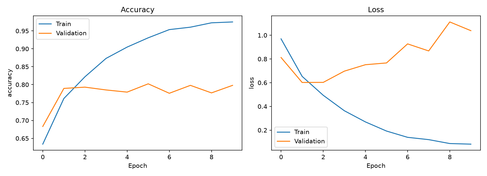
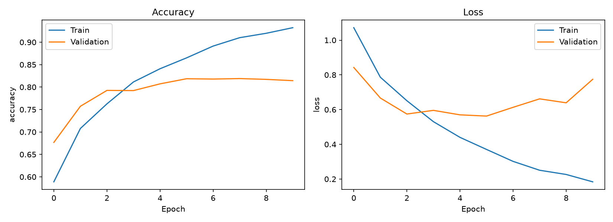
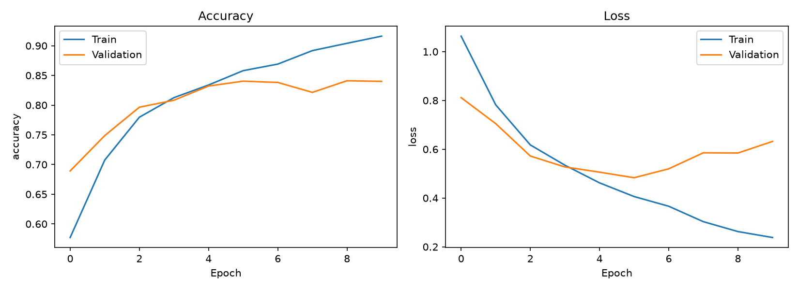
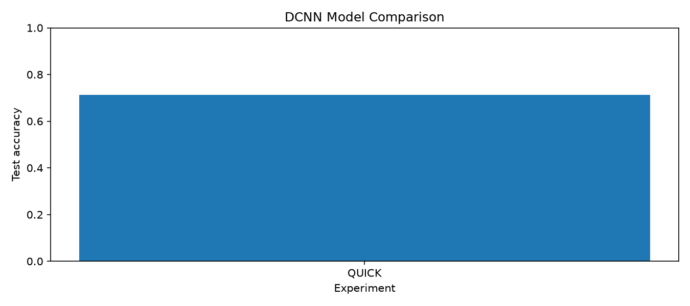
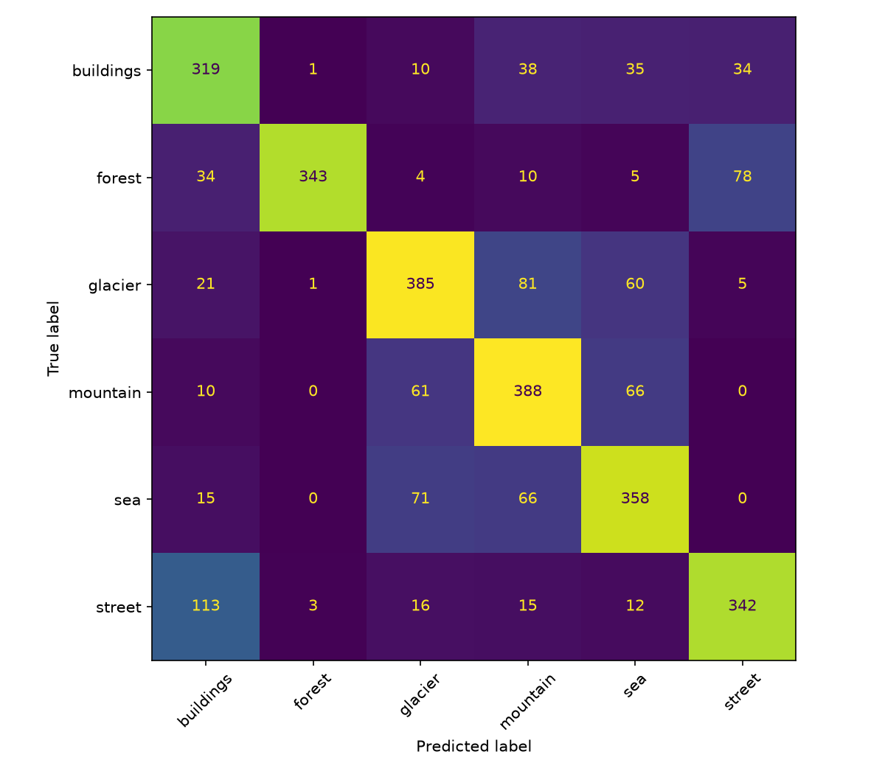
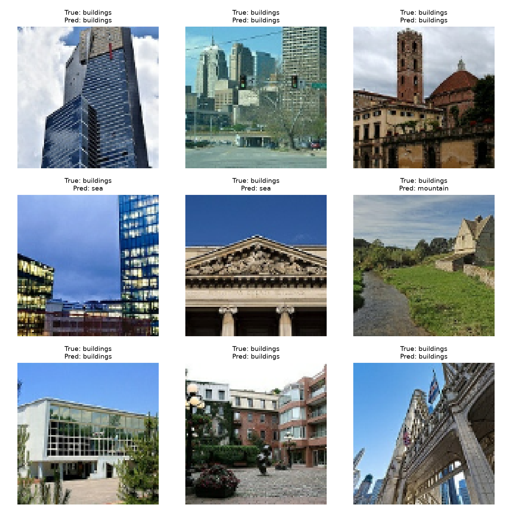

# LAB08 - Deep Convolutional Neural Network (DCNN)

## 1. บทนำ (Introduction)

การทดลองนี้เป็นการนำ Deep Convolutional Neural Network (DCNN) มาใช้จำแนกรูปภาพ โดยเลือกใช้ Intel Image Classification Dataset จาก Kaggle เพื่อศึกษาว่าจำนวน Convolutional Layers, Neurons และ Epochs ที่แตกต่างกัน ส่งผลต่อความแม่นยำของโมเดลอย่างไร

## 2. Dataset ที่ใช้

**Dataset:** [Intel Image Classification – Kaggle](https://www.kaggle.com/datasets/puneet6060/intel-image-classification)

ชุดข้อมูลประกอบด้วยภาพสถานที่และธรรมชาติ 6 ประเภท ได้แก่

- Buildings (อาคาร)
- Forest (ป่าไม้)
- Glacier (ธารน้ำแข็ง)
- Mountain (ภูเขา)
- Sea (ทะเล)
- Street (ถนน)

มีข้อมูล Training 14,034 ภาพ และ Testing 3,000 ภาพ โดยนำมาใช้ฝึกและทดสอบความสามารถในการจำแนกภาพของโมเดล

## 3. โครงสร้างโปรเจกต์ (Project Structure)

```text
LAB08/
├── classification/
│   ├── main.py             # โปรแกรมหลัก
│   ├── data_loader.py      # โหลด Dataset
│   ├── preprocessing.py    # เตรียมรูปภาพ
│   ├── split_data.py       # แบ่งข้อมูล
│   ├── dcnn_model.py       # สร้างโมเดล DCNN
│   ├── evaluate.py         # ประเมินผลและสร้างกราฟ
│   ├── test_model.py       # ทดสอบการทำนาย
│   └── outputs/            # เก็บผลการทดลอง
├── requirements.txt
└── README.md
```

## 4. ขั้นตอนการทดลอง (Methodology)

1. โหลด Dataset และปรับขนาดรูปภาพ
2. ปรับค่าพิกเซลให้อยู่ในช่วง 0–1
3. แบ่งข้อมูล Training, Validation และ Testing
4. สร้างโมเดล DCNN ด้วย TensorFlow/Keras
5. ทดลองเปลี่ยนจำนวน Layers, Neurons และ Epochs
6. เปรียบเทียบ Accuracy, Loss และผลการทำนาย

### รูปแบบการทดลอง

| Model | Conv Layers | Neurons | Epochs |
|---|---:|---:|---:|
| A | 2 | 128 | 10 |
| B | 3 | 128 | 10 |
| C | 4 | 128 | 10 |
| D | 3 | 128 | 20 |
| E | 3 | 128 | 30 |
| F | 3 | 256 | 10 |

## 5. วิธีรันโปรแกรม (How to Run)

ติดตั้ง Library:

```powershell
pip install -r requirements.txt
```

ทดลองรันแบบรวดเร็ว:

```powershell
python -m classification.main --quick
```

ฝึกโมเดลทั้งหมด:

```powershell
python -m classification.main
```

ทดสอบการทำนาย:

```powershell
python -m classification.test_model
```

## 6. ผลการทดลอง (Experimental Results)

### Training Accuracy และ Loss

กราฟใช้ดูการเปลี่ยนแปลงของ Accuracy และ Loss ระหว่าง Training และ Validation ในแต่ละ Epoch

**Model A**



**Model B**



**Model C**



### เปรียบเทียบความแม่นยำของโมเดล



### Confusion Matrix



### ผลการทำนายภาพ



## 7. วิเคราะห์ผลการทดลอง (Discussion)

การทดลองนี้เน้นเปรียบเทียบปัจจัย 3 อย่าง ได้แก่

- **Convolutional Layers:** ศึกษาว่าการเพิ่มจำนวนชั้นช่วยให้โมเดลจำแนกภาพได้ดีขึ้นหรือไม่
- **Epochs:** ตรวจสอบว่าการเพิ่มรอบฝึกช่วยเพิ่ม Accuracy หรือทำให้เกิด Overfitting
- **Neurons:** เปรียบเทียบจำนวน Neurons ที่ต่างกันว่ามีผลต่อประสิทธิภาพมากน้อยเพียงใด

การวิเคราะห์จะดูทั้ง Training Accuracy, Validation Accuracy และ Loss เพื่อประเมินความสามารถของโมเดลกับข้อมูลที่ไม่เคยใช้ฝึก

## 8. สรุป (Conclusion)

จากการทำ LAB08 ได้ศึกษาวิธีสร้างและฝึกโมเดล DCNN สำหรับจำแนกภาพ 6 ประเภท รวมถึงการทดลองปรับจำนวน Layers, Neurons และ Epochs

สิ่งที่ได้เรียนรู้คือการเพิ่มความซับซ้อนของโมเดลหรือเพิ่มจำนวน Epochs ไม่จำเป็นต้องทำให้ผลการจำแนกดีขึ้นเสมอไป จึงต้องเปรียบเทียบ Accuracy และ Loss ก่อนเลือกโมเดลที่เหมาะสม

## 9. แหล่งอ้างอิง (References)

- [Intel Image Classification Dataset – Kaggle](https://www.kaggle.com/datasets/puneet6060/intel-image-classification)
- [TensorFlow Documentation](https://www.tensorflow.org/)
- [Keras Documentation](https://keras.io/)
- เอกสารประกอบการเรียน Machine Learning Chapter 8: DCNN
