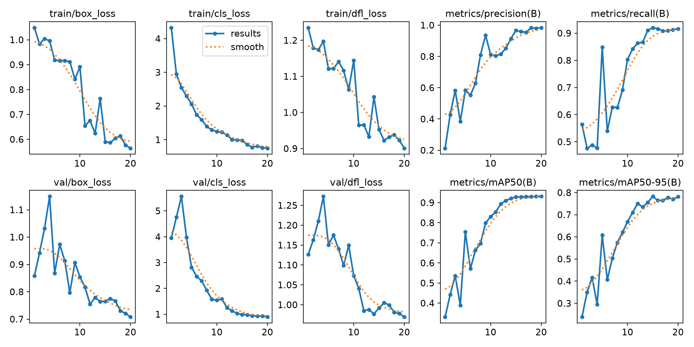
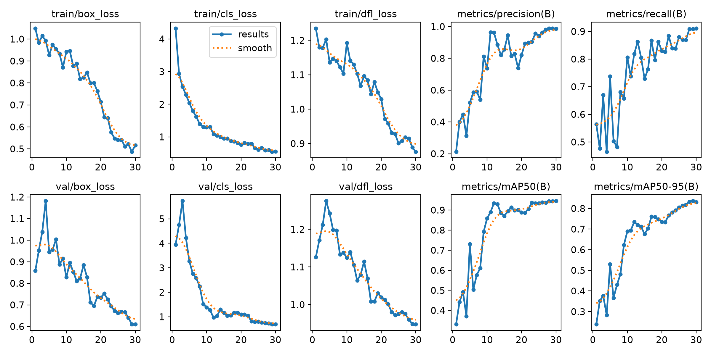
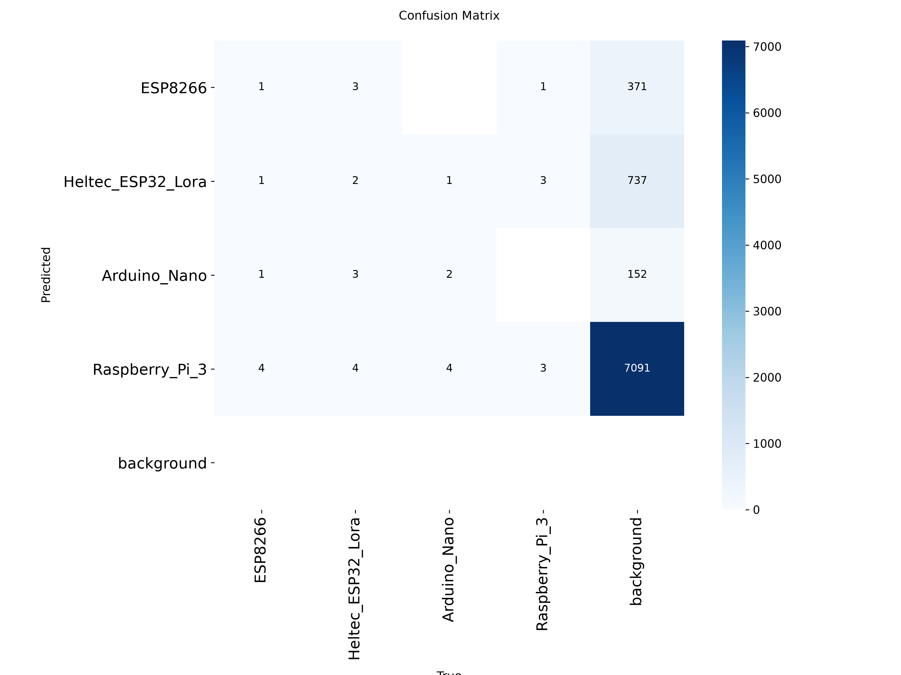
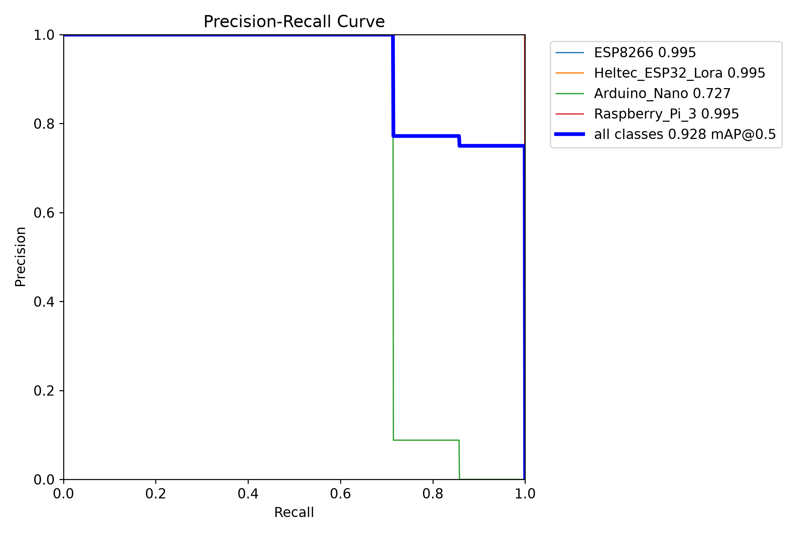

# LAB10 - Object Detection Using YOLOv8

## 1. บทนำ (Introduction)

การทดลอง LAB10 เป็นการนำ YOLOv8 (You Only Look Once) มาใช้ตรวจจับและจำแนกอุปกรณ์ไมโครคอนโทรลเลอร์จากรูปภาพ โดยสามารถระบุตำแหน่งวัตถุด้วย Bounding Box พร้อมแสดงชื่ออุปกรณ์และค่าความมั่นใจ (Confidence Score)

ในการทดลองนี้จะเปรียบเทียบจำนวน Epochs, Image Size และ Batch Size ที่แตกต่างกัน เพื่อศึกษาว่าการปรับค่าต่าง ๆ ส่งผลต่อประสิทธิภาพการตรวจจับวัตถุอย่างไร

## 2. Dataset ที่ใช้ (Dataset)

**Dataset:** [Microcontroller Detection – Kaggle](https://www.kaggle.com/datasets/tannergi/microcontroller-detection)

ใช้ชุดข้อมูลภาพอุปกรณ์ไมโครคอนโทรลเลอร์ทั้งหมด 149 ภาพ ประกอบด้วย 4 Classes ได้แก่

| Class | อุปกรณ์ |
|---|---|
| 0 | ESP8266 |
| 1 | Heltec ESP32 LoRa |
| 2 | Arduino Nano |
| 3 | Raspberry Pi 3 |

ข้อมูลเดิมมี Annotation ในรูปแบบ XML จึงต้องแปลงเป็น YOLO TXT ก่อนนำไปฝึกโมเดล และแบ่งข้อมูลออกเป็น Training, Validation และ Testing

## 3. โครงสร้างโปรเจกต์ (Project Structure)

```text
LAB10/
├── detection/
│   ├── main.py           # โปรแกรมหลัก
│   ├── data_loader.py    # เตรียมข้อมูลและแปลง XML
│   ├── train.py          # ฝึกโมเดล YOLOv8
│   ├── evaluate.py       # ประเมิน Precision, Recall, mAP
│   ├── image_test.py     # ตรวจจับวัตถุจากรูปภาพ
│   ├── video_test.py     # ตรวจจับวัตถุจากวิดีโอ
│   └── realtime_test.py  # ตรวจจับผ่าน Webcam
│
├── dataset/               # ข้อมูล Train / Val / Test
├── outputs/               # บันทึกโมเดลและกราฟ
├── requirements.txt
└── README.md
```

**หน้าที่ของโปรแกรม**

- `main.py` ใช้ควบคุมการทดลองและเรียกใช้ส่วนต่าง ๆ
- `data_loader.py` ใช้โหลด Dataset และแปลง Annotation เป็น YOLO Format
- `train.py` ใช้ฝึกโมเดลโดยปรับจำนวน Epochs, Image Size และ Batch Size
- `evaluate.py` ใช้ประเมิน Precision, Recall และ mAP
- `image_test.py` ใช้ตรวจจับอุปกรณ์จากภาพ
- `video_test.py` ใช้ตรวจจับอุปกรณ์จากวิดีโอ
- `realtime_test.py` ใช้ตรวจจับอุปกรณ์ผ่าน Webcam

## 4. ขั้นตอนการทดลอง (Methodology)

1. ดาวน์โหลด Dataset จาก Kaggle
2. แปลง Annotation จาก XML เป็น YOLO TXT
3. แบ่งข้อมูลเป็น Training, Validation และ Testing
4. โหลดโมเดล YOLOv8n ที่ผ่านการฝึกมาแล้ว
5. ทดลองเปลี่ยน Epochs, Image Size และ Batch Size
6. ประเมินผลด้วย Precision, Recall และ mAP
7. ทดสอบการตรวจจับวัตถุจากรูปภาพ วิดีโอ และ Webcam

### รูปแบบการทดลอง

| Model | Epochs | Image Size | Batch Size |
|---|---:|---:|---:|
| Model A | 10 | 416 | 8 |
| Model B | 20 | 416 | 8 |
| Model C | 30 | 416 | 8 |
| Model D | 20 | 640 | 8 |
| Model E | 20 | 416 | 16 |

การทดลองแบ่งเป็นการเปรียบเทียบจำนวน Epochs (Model A–C), Image Size (Model B และ D) และ Batch Size (Model B และ E)

## 5. วิธีติดตั้งและรันโปรแกรม (How to Run)

ใช้ Python 3.11 และ VS Code สำหรับพัฒนาโปรแกรม

**ติดตั้ง Libraries**

```powershell
py -3.11 -m venv .venv
.\.venv\Scripts\python.exe -m pip install -r requirements.txt
```

**ทดลองรันแบบรวดเร็ว**

```powershell
.\.venv\Scripts\python.exe -m detection.main --quick
```

**ฝึกโมเดลทั้งหมด**

```powershell
.\.venv\Scripts\python.exe -m detection.main
```

**ทดสอบตรวจจับจากรูปภาพ**

```powershell
.\.venv\Scripts\python.exe -m detection.image_test
```

**ทดสอบตรวจจับจากวิดีโอ**

```powershell
.\.venv\Scripts\python.exe -m detection.video_test
```

**ตรวจจับผ่าน Webcam**

```powershell
.\.venv\Scripts\python.exe -m detection.realtime_test
```

## 6. ผลการทดลอง (Experimental Results)

### 6.1 Training and Validation Results

กราฟแสดงค่า Training Loss, Validation Loss, Precision, Recall และ mAP ที่เปลี่ยนแปลงระหว่างการฝึกโมเดลแต่ละ Epoch

**Model A – Training Results**


**Model B – Training Results**



**Model C – Training Results**



**Model D – Training Results**


**Model E – Training Results**


### 6.2 Model Comparison

กราฟเปรียบเทียบค่า mAP ของแต่ละโมเดล เพื่อศึกษาว่า Configuration ใดให้ประสิทธิภาพการตรวจจับดีที่สุด


### 6.3 Confusion Matrix

ใช้ตรวจสอบความถูกต้องในการตรวจจับอุปกรณ์แต่ละ Class และวิเคราะห์ว่ามีการจำแนกผิดระหว่างอุปกรณ์ประเภทใดบ้าง



### 6.4 Precision–Recall Curve

กราฟแสดงความสัมพันธ์ระหว่าง Precision และ Recall เพื่อประเมินความสามารถในการตรวจจับวัตถุของโมเดล



### 6.5 Object Detection Results

ใช้โมเดลที่ฝึกแล้วทดสอบตรวจจับอุปกรณ์ โดยแสดง Bounding Box พร้อม Class Name และ Confidence Score

ผลการทดสอบสามารถนำไปประยุกต์ใช้กับรูปภาพ วิดีโอ และ Webcam แบบ Real-time

*เพิ่มภาพผลการตรวจจับจริงจากโฟลเดอร์ outputs หลังการทดสอบ*

### 6.6 ตารางเปรียบเทียบผลการทดลอง

| Model | Precision | Recall | mAP50 | mAP50-95 |
|---|---|---|---|---|
| A | รอผล | รอผล | รอผล | รอผล |
| B | รอผล | รอผล | รอผล | รอผล |
| C | รอผล | รอผล | รอผล | รอผล |
| D | รอผล | รอผล | รอผล | รอผล |
| E | รอผล | รอผล | รอผล | รอผล |

## 7. วิเคราะห์ผลการทดลอง (Discussion)

การทดลองนี้เป็นการเปรียบเทียบปัจจัยที่ส่งผลต่อประสิทธิภาพของ YOLOv8 โดยมีประเด็นสำคัญดังนี้

**1. จำนวน Epochs**

ทดลองเปลี่ยนจำนวน Epochs ระหว่าง 10, 20 และ 30 เพื่อศึกษาว่าการเพิ่มรอบฝึกช่วยเพิ่มประสิทธิภาพการตรวจจับหรือไม่ โดยดูค่า mAP และ Validation Loss ร่วมกัน

**2. Image Size**

เปรียบเทียบภาพขนาด 416 และ 640 พิกเซล เพื่อดูว่าการใช้ภาพที่มีความละเอียดสูงขึ้นช่วยให้ตรวจจับอุปกรณ์ได้ดีขึ้นหรือไม่

**3. Batch Size**

เปรียบเทียบ Batch Size 8 และ 16 เพื่อศึกษาผลของจำนวนภาพที่ใช้ในการปรับน้ำหนักโมเดลแต่ละครั้ง

เนื่องจาก Dataset มีจำนวนภาพค่อนข้างน้อย ผลการทดลองอาจมีความผันผวน จึงต้องวิเคราะห์ค่าความแม่นยำร่วมกับกราฟ Loss และผลการตรวจจับจริง

## 8. สรุป (Conclusion)

การทดลอง LAB10 เป็นการศึกษาการใช้งาน YOLOv8 สำหรับตรวจจับอุปกรณ์ไมโครคอนโทรลเลอร์ 4 ประเภท โดยนำ Pretrained Model มาฝึกเพิ่มเติมกับ Dataset ที่เลือก

จากการทดลองได้ศึกษาขั้นตอนการเตรียมข้อมูล การแปลง Annotation การฝึกโมเดล และการประเมินประสิทธิภาพด้วย Precision, Recall และ mAP

การเปรียบเทียบ Epochs, Image Size และ Batch Size ช่วยให้สามารถวิเคราะห์และเลือกค่าที่เหมาะสมกับการตรวจจับวัตถุได้ โดยพิจารณาทั้งความแม่นยำและข้อจำกัดของ Dataset

## 9. แหล่งอ้างอิง (References)

- [Microcontroller Detection Dataset – Kaggle](https://www.kaggle.com/datasets/tannergi/microcontroller-detection)
- [Ultralytics YOLO Documentation](https://docs.ultralytics.com/)
- [OpenCV Documentation](https://docs.opencv.org/)
- เอกสารประกอบการเรียน Machine Learning Chapter 10: Object Detection II
