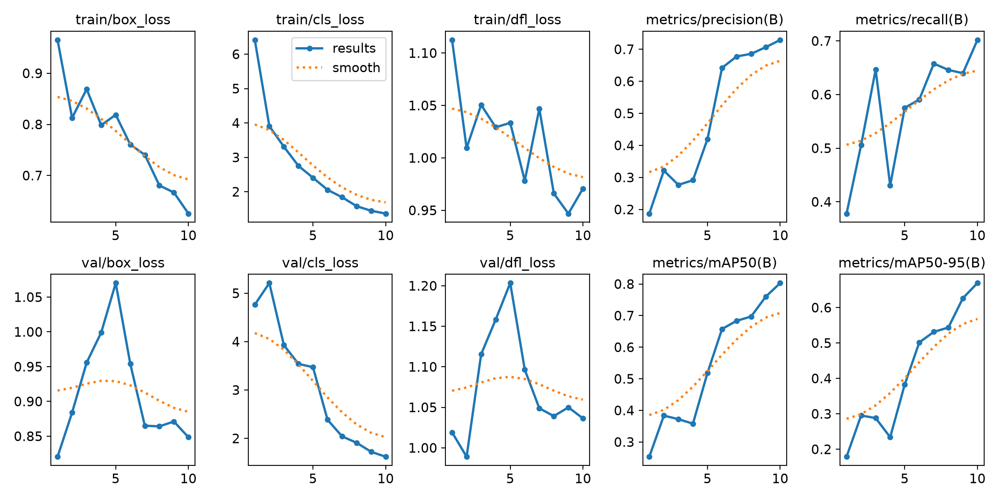
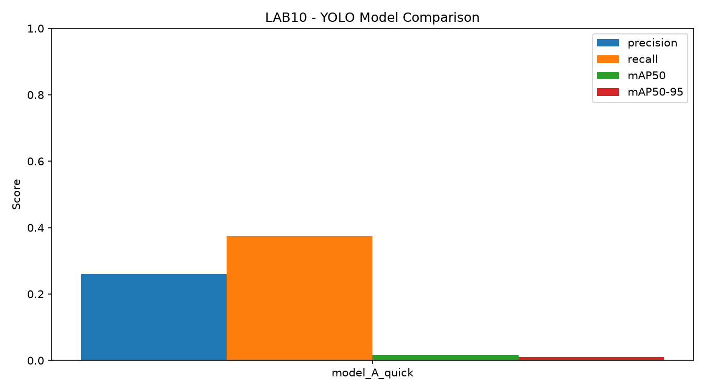
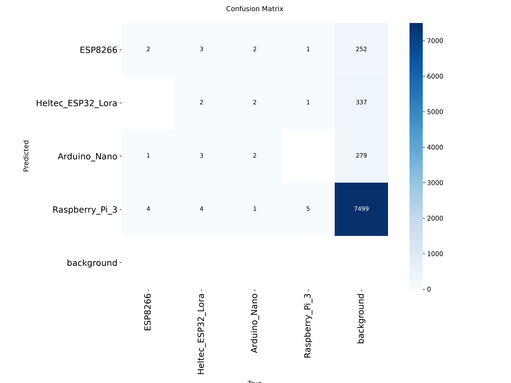

# LAB10 - Object Detection Using YOLOv8

## 1. บทนำ (Introduction)

การทดลองนี้ใช้ YOLOv8 ตรวจจับอุปกรณ์ไมโครคอนโทรลเลอร์จากรูปภาพ โดยแสดงกรอบตำแหน่งวัตถุ (Bounding Box) ชื่ออุปกรณ์ และค่าความมั่นใจ (Confidence Score) พร้อมทดลองปรับ Epochs, Image Size และ Batch Size เพื่อเปรียบเทียบประสิทธิภาพของโมเดล

## 2. Dataset

**แหล่งข้อมูล:** [Microcontroller Detection – Kaggle](https://www.kaggle.com/datasets/tannergi/microcontroller-detection)

ใช้รูปภาพทั้งหมด 149 ภาพ แบ่งเป็นอุปกรณ์ 4 ประเภท ได้แก่

- ESP8266
- Heltec ESP32 LoRa
- Arduino Nano
- Raspberry Pi 3

ข้อมูล Bounding Box เดิมเป็นไฟล์ XML จึงแปลงเป็น YOLO Format ก่อนนำไปฝึกโมเดล

## 3. Project Structure

```text
LAB10/
├── detection/
│   ├── main.py          # โปรแกรมหลัก
│   ├── data_loader.py   # เตรียม Dataset
│   ├── train.py         # ฝึก YOLO
│   ├── evaluate.py      # ประเมินผล
│   ├── image_test.py    # ทดสอบรูปภาพ
│   ├── video_test.py    # ทดสอบวิดีโอ
│   └── realtime_test.py # ทดสอบ Webcam
├── dataset/              # ข้อมูลที่เตรียมแล้ว
├── outputs/              # กราฟและผลลัพธ์
├── requirements.txt
└── README.md
```

## 4. ขั้นตอนการทดลอง

1. เตรียม Dataset และแปลง XML เป็น YOLO
2. แบ่งข้อมูล Train, Validation และ Test
3. ฝึก Pretrained YOLOv8n ด้วยค่าที่แตกต่างกัน
4. เปรียบเทียบ Precision, Recall และ mAP
5. ทดสอบตรวจจับอุปกรณ์จากรูปภาพ วิดีโอ และ Webcam

### Training Configurations

| Model | Epochs | Image Size | Batch |
|---|---:|---:|---:|
| A | 10 | 416 | 8 |
| B | 20 | 416 | 8 |
| C | 30 | 416 | 8 |
| D | 20 | 640 | 8 |
| E | 20 | 416 | 16 |

## 5. วิธีรันโปรแกรม

ติดตั้ง Libraries:

```powershell
py -3.11 -m venv .venv
.\.venv\Scripts\python.exe -m pip install -r requirements.txt
```

เริ่ม Training:

```powershell
.\.venv\Scripts\python.exe -m detection.main
```

ทดสอบตรวจจับรูปภาพ:

```powershell
.\.venv\Scripts\python.exe -m detection.image_test
```

ทดสอบผ่าน Webcam:

```powershell
.\.venv\Scripts\python.exe -m detection.realtime_test
```

## 6. ผลการทดลอง (Results)

### Training Results

กราฟแสดงค่า Loss, Precision, Recall และ mAP ระหว่างการฝึก



### Model Comparison

เปรียบเทียบประสิทธิภาพของแต่ละโมเดล



### Confusion Matrix

ตรวจสอบผลการจำแนกอุปกรณ์แต่ละประเภท



## 7. วิเคราะห์และสรุปผล (Discussion & Conclusion)

การทดลองนี้ใช้เปรียบเทียบผลของ Epochs, Image Size และ Batch Size ต่อการตรวจจับวัตถุด้วย YOLOv8 โดยพิจารณาจาก Precision, Recall, mAP และ Loss

การเพิ่มจำนวน Epochs หรือปรับ Image Size ไม่ได้ทำให้โมเดลแม่นยำขึ้นเสมอไป จึงต้องพิจารณาผล Validation ร่วมด้วย นอกจากนี้ Dataset มีจำนวนภาพค่อนข้างน้อย อาจทำให้ผลการตรวจจับมีความผันผวน

## 8. References

- [Microcontroller Detection Dataset – Kaggle](https://www.kaggle.com/datasets/tannergi/microcontroller-detection)
- [Ultralytics YOLO Documentation](https://docs.ultralytics.com/)
- เอกสารประกอบการเรียน Machine Learning Chapter 10: Object Detection II
